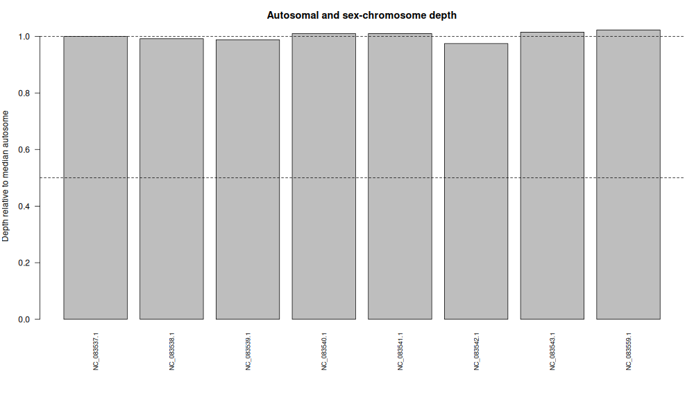

# Sex-Chromosome Dosage Analysis in *Danaus plexippus*

**Cell and Molecular Biology**

**Name:** Richelle O. Gregorio  
**Species:** *Danaus plexippus* (Monarch Butterfly)  
**Sex-Determination System:** ZZ/ZW  
**Reference Assembly:** GCF_018135715.1  
**WGS Run:** SRR1549529  
**Galaxy History:** [Sex_Dosage_Danaus_plexippus](https://usegalaxy.org/histories/view?id=bbd44e69cb8906b5815eb97c43e9b982)

---

## I. Introduction

Sex-chromosome dosage analysis uses sequencing depth to compare sex chromosomes with autosomes. In *Danaus plexippus*, males have a ZZ chromosome complement, while females have a ZW chromosome complement.
In this activity, I used NCBI, Galaxy, and R to analyze whole-genome sequencing data. By comparing the sequencing depth of the Z chromosome with the autosomes, I aimed to infer the sex-chromosome complement of the sequenced individual.

## II. Reference Genome and Sequencing Data

| Information | Details |
|---|---|
| Species | *Danaus plexippus* |
| Common name | Monarch butterfly |
| Sex-determination system | ZZ/ZW |
| Assembly accession | GCF_018135715.1 |
| Assembly name | MEX_DaPlex |
| Assembly BioSample | SAMN16239029 |
| WGS run | SRR1549529 |
| WGS BioSample | SAMN02986443 |
| Sequencing platform | Illumina |
| Library layout | Paired-end |
| Recorded WGS donor sex | Male |
| Z chromosome accession | NC_083559.1 |

The reference assembly and WGS run have different BioSample accessions. Therefore, the sex inference applies to the WGS sample rather than automatically to the reference assembly donor.


---

## III. Step-by-Step Galaxy Analysis
### Step 1. Obtain the Reference Genome
I visited NCBI and searched for *Danaus plexippus*, selected the reference assembly **GCF_018135715.1 (MEX_DaPlex)** and downloaded its genomic FASTA file.

**Reference file:** `GCF_018135715.1_MEX_DaPlex_genomic.fna` I uploaded the reference genome to Galaxy.


---

### Step 2. Obtain the WGS Reads
I searched NCBI SRA for accession **SRR1549529** and imported the paired-end whole-genome sequencing reads into Galaxy. The forward and reverse reads were used for the alignment.


---

### Step 3. Assess Read Quality Using FastQC
I searched for **FastQC** in Galaxy Tols and ran it separately on the forward and reverse reads. I examined the quality reports to assess the sequencing data before alignment.


---

### Step 4. Align Reads Using BWA-MEM
I searched for **Map with BWA-MEM** in Galaxy and selected the following inputs:

- Reference genome: Uploaded *Danaus plexippus* FASTA file
- Sequencing data: Paired-end
- Forward reads: SRR1549529 forward reads
- Reverse reads: SRR1549529 reverse reads

I ran BWA-MEM to align the sequencing reads against the reference genome and obtained a BAM alignment file.


---

### Step 5. Calculate Chromosome Coverage
I searched for **Samtools coverage** in Galaxy and selected the aligned BAM file, ran the tool to calculate chromosome coverage statistics, including mean sequencing depth and saved the resulting table as `chromosome_coverage.tsv`.


---

### Step 6. Identify the Chromosomes
I used the NCBI assembly report to identify the autosomes and Z chromosome and saved the classifications in `chromosome_groups.csv`.


---

| Accession | Chromosome | Group |
|---|---|---|
| NC_083537.1 | 2 | A |
| NC_083538.1 | 4 | A |
| NC_083539.1 | 5 | A |
| NC_083540.1 | 6 | A |
| NC_083541.1 | 7 | A |
| NC_083542.1 | 8 | A |
| NC_083543.1 | 10 | A |
| NC_083559.1 | Z | Z |


---

### Step 7. Analyze Chromosome Depth Using R
I imported the coverage table and chromosome classification file into R. and used `sex_depth_analysis.R` to calculate the median autosomal depth, relative chromosome depths, and Z:A ratio.
The analysis generated three output files:
1. `chromosome_relative_depth.csv`
2. `chromosome_depth.png`
3. `sex_inference.txt`

The median autosomal depth was **7.788**, and the Z:A ratio was **1.023**. This indicated a **ZZ-like chromosome dosage pattern**, consistent with a male *Danaus plexippus*. The result agreed with the male sex recorded in NCBI BioSample SAMN02986443.

---

## IV. R Script and Analysis

The R script `sex_depth_analysis.R` was used to process the chromosome coverage data, calculate relative depth, and determine the sex-chromosome dosage pattern.

The analysis followed these steps:
1. Import `chromosome_coverage.tsv` and `chromosome_groups.csv`.
2. Match the chromosome accessions with their coverage values.
3. Calculate the median autosomal sequencing depth.
4. Divide the Z chromosome depth by the median autosomal depth.
5. Classify the resulting Z:A ratio.
6. Generate the chromosome depth table, graph, and sex inference summary.

**R script:** [sex_depth_analysis.R](sex_depth_analysis.R)

## V. Results

### A. Chromosome Depth

| Chromosome | Group | Mean depth | Relative depth |
|---|---|---:|---:|
| 2 | A | 7.78848 | 1.000 |
| 4 | A | 7.72634 | 0.992 |
| 5 | A | 7.69693 | 0.988 |
| 6 | A | 7.86687 | 1.010 |
| 7 | A | 7.86641 | 1.010 |
| 8 | A | 7.59177 | 0.975 |
| 10 | A | 7.90566 | 1.015 |
| Z | Z | 7.96688 | 1.023 |

### B. Sex Inference Results

The R output `sex_inference.txt` reported:

```text
Median autosome depth: 7.788
Z / A ratio: 1.023
W / A ratio: NA
Dosage interpretation: ZZ-like
Compare with BioSample sex and discuss limitations.
```

The Z:A ratio of 1.023 indicates a ZZ-like chromosome dosage pattern, consistent with a male monarch butterfly. The W:A ratio was unavailable because the W chromosome was not included in the analysis.

### C. Chromosome Depth Graph



**Figure 1.** Relative sequencing depth of seven autosomes and one Z chromosome in *Danaus plexippus*. The Z chromosome has a relative depth of 1.023, supporting a ZZ-like dosage pattern.

### D. R Output Files

| File | Description |
|---|---|
| [chromosome_relative_depth.csv](results/chromosome_relative_depth.csv) | Relative sequencing depth of the selected chromosomes |
| [chromosome_depth.png](results/chromosome_depth.png) | Chromosome depth graph |
| [sex_inference.txt](results/sex_inference.txt) | Sex inference summary |

The Z:A ratio of **1.023** shows that the Z chromosome has nearly the same sequencing depth as the autosomes. This supports a ZZ-like chromosome complement, consistent with a male *Danaus plexippus*. The result agrees with the male sex recorded in NCBI BioSample SAMN02986443. However, the inference is based on sequencing depth, which may be affected by mapping bias, repetitive sequences, low coverage, and reference genome errors. The W chromosome was not analyzed, so its coverage could not be determined.

---

## VI. Questions for the Report

### 1. What species did you choose, and what evidence supports a diploid XX/XY or ZZ/ZW system?

I chose *Danaus plexippus*, commonly known as the monarch butterfly. It is a diploid animal with a ZZ/ZW sex-determination system, where males are ZZ and females are ZW. The NCBI reference assembly also identifies a Z chromosome.

### 2. What are your assembly accession, WGS run, and both BioSample accessions? Are the donors the same?

The reference assembly accession is GCF_018135715.1, with BioSample SAMN16239029. The WGS run is SRR1549529, with BioSample SAMN02986443. These are different BioSample records, so they should not be assumed to represent the same donor.

### 3. Which sequences were used as autosomes and as X or Z? How did you verify their identities?

I selected seven autosomes: NC_083537.1, NC_083538.1, NC_083539.1, NC_083540.1, NC_083541.1, NC_083542.1, and NC_083543.1. The Z chromosome was NC_083559.1. I verified the chromosome identities using the NCBI assembly report and matched their accessions with the Samtools coverage output.

### 4. What are the median autosomal depth, X:A or Z:A ratio, and inferred sex-chromosome complement?

The median autosomal depth was **7.788**, and the Z:A ratio was **1.023**. Since the ratio is close to 1.0, the result indicates a ZZ-like chromosome dosage pattern, consistent with a male individual.

### 5. Does your result agree with the recorded sex of the WGS donor, if reported? Explain any discrepancy or uncertainty.

Yes. The NCBI BioSample record identifies the WGS donor as male, which agrees with the ZZ-like dosage result. There was no discrepancy. However, sequencing depth can be affected by mapping bias, repetitive sequences, and reference genome errors.

### 6. Why is a chromosome-level assembly alone insufficient for a reliable read-depth sex inference?

A chromosome-level assembly identifies the chromosomes but does not determine their copy number in the sequenced individual. Whole-genome sequencing reads are needed to measure chromosome coverage and compare the sex chromosome with the autosomes.

---

## VII. Conclusion

The sex-chromosome dosage analysis of *Danaus plexippus* produced a Z:A ratio of **1.023**, indicating a **ZZ-like chromosome dosage pattern**, consistent with a male individual. This agrees with the recorded male sex of the WGS donor. Although the inference may be affected by sequencing and mapping limitations, the results support the male sex inference.

**Limitations:** The sex inference was based on sequencing depth, which may be affected by mapping bias, repetitive sequences, and reference genome errors. The W chromosome was not included in the analysis, so its coverage could not be determined.

---

## VIII. Galaxy History and References

**Galaxy History Name:** `Sex_Dosage_Danaus_plexippus`

**Galaxy History Link:** https://usegalaxy.org/histories/view?id=bbd44e69cb8906b5815eb97c43e9b982

---

### References

1. NCBI Reference Assembly: https://www.ncbi.nlm.nih.gov/datasets/genome/GCF_018135715.1/
2. NCBI SRA Run: https://www.ncbi.nlm.nih.gov/sra/SRR1549529
3. NCBI WGS BioSample: https://www.ncbi.nlm.nih.gov/biosample/SAMN02986443
4. NCBI Assembly BioSample: https://www.ncbi.nlm.nih.gov/biosample/SAMN16239029
5. Galaxy Project: https://usegalaxy.org/
6. R Project: https://www.r-project.org/
